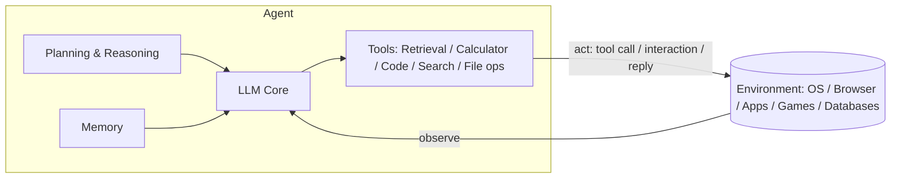
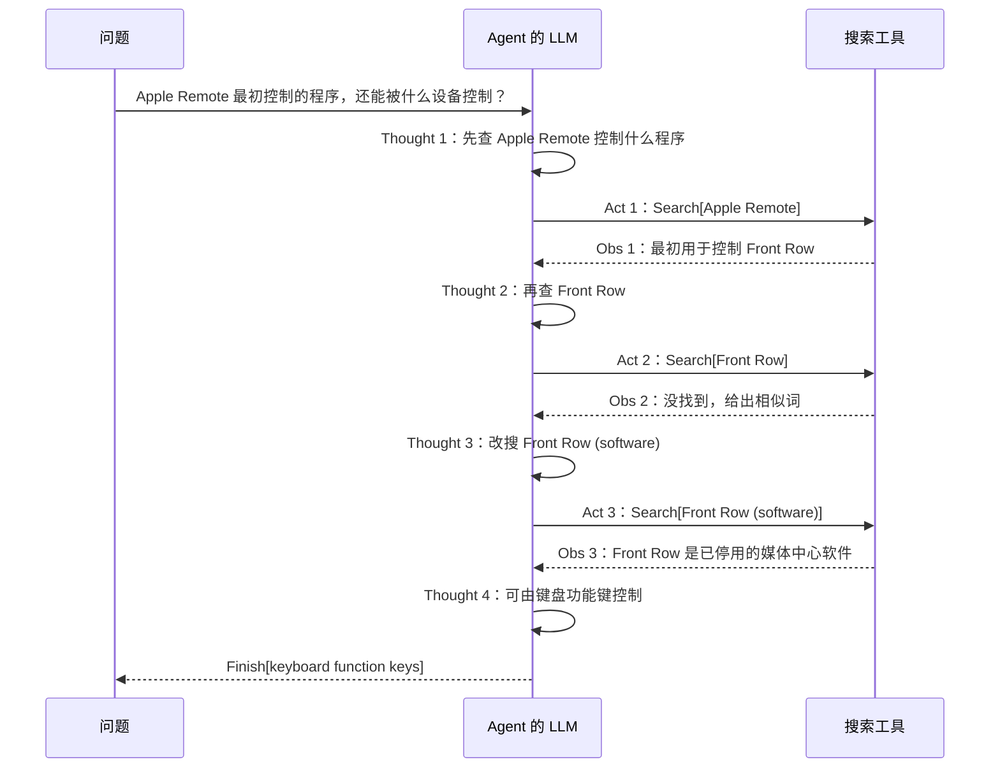
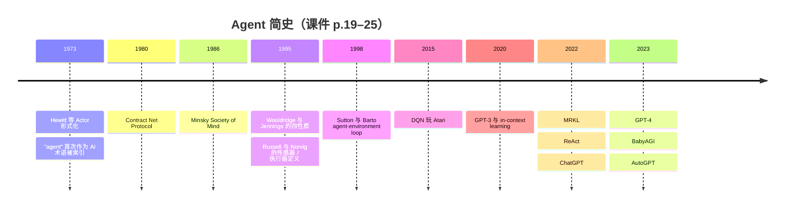
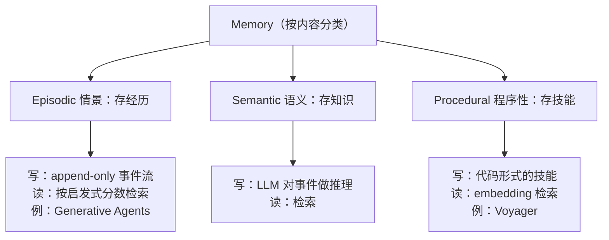
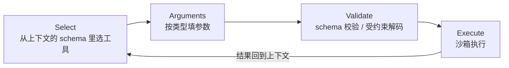
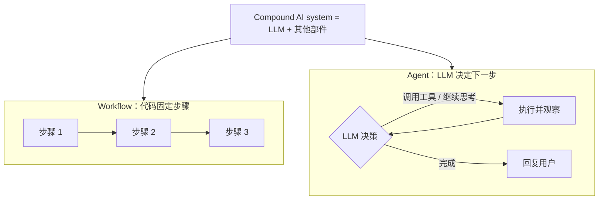
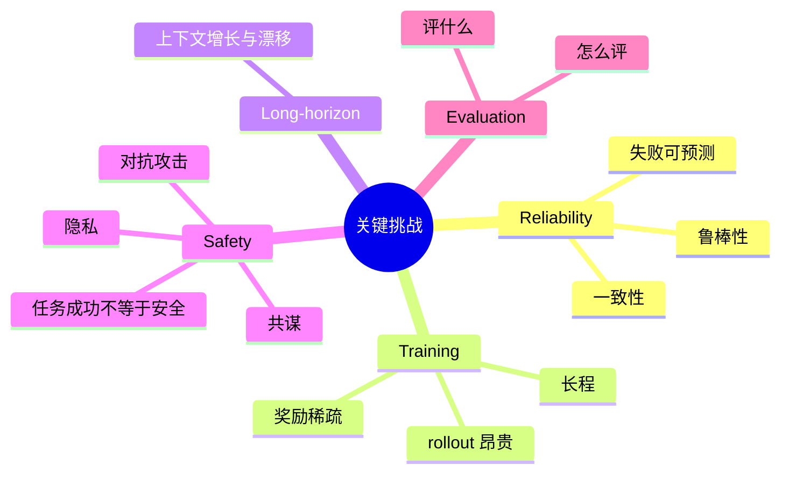

# L01 导论：什么是 Agentic Systems

> 本页是个人学习笔记：用自己的话复述并整理，不复制课件图片。对应课件共 71 页，文中的 “p.N” 指课件页码，方便回查官方 PDF。凡是课件之外的补充，都会标出（补充）。

## 概览

**一句话**：Agent = 以 LLM 为核心，围绕它搭上推理 / 规划、记忆、工具三块能力，在环境里 “观察 → 思考 → 行动” 循环的系统；做 agent 是工程活，要同时管 **系统、数据、评测** 三层，而难点集中在可靠性、训练、长程任务、安全和评测。

**课程定位（p.5–6）**：课程希望把两类人的视角合起来。

- LLM 人懂模型怎么训练、提示、对齐、评测。
- Systems 人懂怎样做可靠的软件：工具、API、环境、基础设施。
- 形式是 “基础理论讲座 + 动手搭建与评测 agent”。

**本讲结构（p.4、p.17、p.28、p.54、p.60 重复出现的议程页）**

| 板块 | 课件时长 | 内容 | 课件页 |
| --- | --- | --- | --- |
| 课程安排 | 10 分钟 | 联系方式、评分、政策、先修与算力、AI 与技能退化 | p.2–16 |
| Agent 简史 | 15 分钟 | 1990 年前、1990 年代、RL 时代、LLM 时代 | p.18–27 |
| Agent 架构 | 20 分钟 | LLM core、规划与推理、记忆、工具、环境 | p.29–53 |
| Compound AI systems | 10 分钟 | workflow vs agent、RAG、tool use、MCP | p.55–59 |
| 关键挑战 | 15 分钟 | 可靠性、训练、长程、安全、评测 | p.61–70 |

**本讲的学习目标（p.17 原文大意）**：熟悉 LLM 之上的 agent loop、agent 的关键部件，以及 agent 训练与评测里的开放问题。

**读完你应该能回答**：

1. 一个 agent 由哪几块组成，每块的职责是什么？
2. ReAct 为什么比 “只推理” 或 “只行动” 好？
3. workflow 和 agent 的分界线在哪？为什么说两者都属于 compound AI system？
4. 为什么 “任务做完了” 不等于 “agent 可靠 / 安全”？

## 核心概念

| 概念 | 一句话解释 | 出处 / 课件页 |
| --- | --- | --- |
| Agent（Russell & Norvig 定义） | 通过传感器感知环境、通过执行器作用于环境的任何东西 | p.21 |
| Agent 的四个特性（Wooldridge & Jennings） | autonomy 自主、social ability 社交、reactivity 反应、proactivity 主动 | p.21 |
| Agent–environment loop | 在状态、动作、奖励之间循环交互的 RL 视角 | p.22 |
| LLM Core | 整个系统的 “大脑”，负责生成下一步的思考或动作 | p.29–30 |
| Planning & Reasoning | 对 agent 自身状态做更新的内部动作（想、拆解、反思） | p.33 |
| ReAct | Thought → Act → Obs 交织循环，把推理和行动放进同一条轨迹 | p.29、p.36 |
| Memory | 存放事件流之外的长期信息：episodic、semantic、procedural 三类 | p.45–49 |
| Tools | 检索、计算器、代码、搜索、文件读写等外部能力 | p.51–52 |
| Environment | 外部世界：桌面系统、浏览器、手机 App、游戏、数据库等 | p.30 |
| Compound AI system | LLM 加上检索器、工具、代码执行等其他部件组成的系统 | p.56 |
| Workflow vs Agent | 步骤由代码固定，还是由 LLM 自己决定 | p.56 |
| 三层 | system（系统）、data（数据）、evals（评测 + 指标） | p.55 |
| RAG | Retrieve 检索 → Augment 增强 → Generate 生成 | p.57 |
| MCP | 连接 AI 应用与数据 / 工具的标准协议 | p.59 |
| Capability–Reliability gap | 能力强不等于可靠：一致性、鲁棒性、失败可预测性 | p.62–63 |

## 详细笔记

### 1. 课程安排与政策（p.2–16）

这一段是行政信息，自学者只需要知道课程怎么设计，用来对照自己的学习安排。

**联系与资源（p.3）**：问题发 Ed，其他事务发邮件给课程组；官方网站和 Ed 讨论区链接见本页末尾的资源列表。

**评分构成（p.8）**

| 项目 | 占比 | 备注 |
| --- | --- | --- |
| 课程项目 | 40% | Proposal 5% + Midway report 5% + Midpoint demo 5% + Final submission 15% + Final system demo 10% |
| 作业 | 15% | 作业要自己搭、自己评测 agent |
| 作业测验 | 15% | 见下方说明 |
| Paper video | 10% | 见下方说明 |
| Peer review | 20% | 见下方说明 |

**三项新形式的作业（p.9，“细节后续公布”）**

- **作业测验（homework-based quiz）**：15 分钟口头检查，可以问你提交内容的任何部分。意思是：用 AI 写可以，但你得讲得清楚。
- **Paper video**：选一篇课上没讲过的 agent 论文，录 10 分钟左右的视频讲解。
- **Peer review**：评审对象包括论文视频、中期演示、agent 评测和最终系统演示。要给出具体、有建设性的反馈；评分看反馈是否有用，以及作者有没有采纳。

**课程政策（p.11）**

- 熟悉斯坦福 honor code。
- “你应该用 AI 来学习”。
- 强烈不建议上课使用笔记本电脑。
- 每人共有 3 天免费迟交（日历日）；peer review 和最终项目论文不能迟交。

**先修与算力（p.12）**

- 强烈建议先修 CS 224N、224V、CS 336 或同等课程。
- 默认你已懂基础 LLM 概念：train / dev / test、预训练、微调、对齐、prompting 等，**课上不再讲**。
- 算力补助：Laude Institute 提供 200 美元，Thinking Machines 提供 250 美元。

**选课（p.13）**：课程已满员，前两周常有空位；课件和视频会公开。这正是本笔记仓库的前提：课件与视频都能公开拿到。

**隐藏成本：技能会退化（p.14–16）**

- p.14 的图表来自一项关于中国中学生的研究（图上来源标为 Strömberg 等人 2026 年 6 月的预印本，样本 26,811 名 12–18 岁学生）。图形表达的意思是：用 AI 的学生，作业成绩更高，但考试成绩反而更低。图中的数据细节我没有逐项核对，需要引用时请回原文查。
- p.15：Anthropic 的 RCT（Shen & Tamkin，2026）：52 名工程师学一个新的 Python 库，分 “有 AI 辅助” 和 “无 AI 辅助” 两组。**用 AI 的一组在随后的小测中低 17%（约两个字母等级）**，差距在 debugging 题上最明显。结论原文是：使用 AI 辅助会带来掌握程度的统计显著下降。
- p.16 的结论是 “Use AI to learn how to learn”，也就是说，这门课怎么学取决于你自己。

::: tip 对自学者的含义
这三页是整门课的态度：鼓励用 AI，但要 “能讲清楚” 才算学会。笔记里的每一讲都应该能不看 AI 输出，自己复述一遍核心机制。
:::

### 2. Agent 简史（p.18–27）

课件把 “agent” 的历史分成四个时期。重点不在记年代，而在看清 **每一次进步到底多了什么**。

**2.1 1990 年之前（p.19–20）**

- “agent” 一词来自拉丁语 *agens*（15 世纪晚期），意思是 “行动的人”。
- 论文里第一次把 agent 用作 AI 术语，被索引到的是 Hewitt、Bishop 和 Steiger 1973 年在 IJCAI 发表的 “A Universal Modular ACTOR Formalism”。
- 1980：**Contract Net Protocol**，多个 agent 之间通过 “发布任务 → 投标 → 中标” 来协商分工（补充：由 Reid G. Smith 提出，用于分布式问题求解）。
- 1986：Marvin Minsky 的 *The Society of Mind*：智能由许多简单的 “agent” 相互作用涌现出来。

**2.2 1990 年代（p.21）**

- Pattie Maes 的 *Designing Autonomous Agents*（课件标注为 1994）。
- Wooldridge 与 Jennings（1995）用四个性质定义 agent：**自主性、社交能力、反应性、主动性**。
- Russell & Norvig 的教科书（1995）：agent 就是 “通过传感器感知、通过执行器行动” 的任何东西。这是最宽泛、也最常被引用的定义。

**2.3 RL 时代（p.22）**

- Sutton & Barto（1998）的 **agent–environment loop**：agent 观察状态 `S_t`，选动作 `A_t`，环境返回奖励 `R_{t+1}` 和新状态。
- DQN 玩 Atari（Mnih et al., 2015），以及 AlphaGo 等系统：在封闭环境里，agent 靠试错学会了策略。
- 局限（补充）：每个环境都要单独训练，动作空间和目标是预先定义好的，难以泛化到开放世界。

**2.4 LLM 时代（p.23–27）**

- p.23：GPT-3 与 **in-context learning**。只在 prompt 里放几个例子，不更新梯度，模型就能完成新任务。这让 “用自然语言指挥一个通用模型” 成为可能。
- p.24：LLM 让两件事变得可行：**推理**（chain-of-thought 等）和 **使用工具**（WebGPT 用浏览器提高事实性，MRKL 把语言模型与外部模块组合起来）。
- p.25 “Agent” 的出现，时间线如下：

| 时间 | 事件 |
| --- | --- |
| 2022 年 10 月 | ReAct（Yao et al.） |
| 2022 年 11 月 30 日 | ChatGPT |
| 2023 年 3 月 14 日 | GPT-4 |
| 2023 年 3 月 28 日 | BabyAGI |
| 2023 年 3 月 30 日 | AutoGPT |

- p.26：模型能力在变好。课件引用了 Epoch AI 的图：多个基准（如 MMLU、MATH、GPQA 等）上的分数随模型代际上升。
- p.27：agent 能力同样在变好。课件展示了 “解决 12 个开源 Python 仓库里 issue” 的成绩随时间上升的趋势（具体数字以原图为准）。

::: info 看史的视角
RL 时代的 agent 在**固定的环境和奖励**里学策略；LLM 时代的 agent 是**先有通用的语言能力，再接上环境**。这是理解后面 “为什么 reasoning 和 tool use 是核心” 的前提。
:::

### 3. Agent 的架构：解剖一个 agent（p.29–53）

#### 3.1 总体骨架（p.29–30）

课件以一条 ReAct 轨迹为例，把轨迹里每一段对应到一个部件：

| 轨迹里的位置 | 对应部件 |
| --- | --- |
| 模型本身 | **LLM Core** |
| Think[…] | **Planning & Reasoning** |
| 到目前为止的轨迹（traces so far） | **Memory** |
| Act: … | **Tools** |
| Obs: … | **Environment** |

p.30 的完整骨架图是整讲的主线，之后每个小节都会把其中一块圈出来放大：

- 中间是 **LLM Core**；上面是 Planning & Reasoning 与 Memory；下面是 Tools（Retrieval、Calculator、Code、Search、File Operations……）。
- 右边是 **Environment（外部世界）**：Desktop OS、Web browser、Mobile apps、Games、Databases 等。
- agent 通过 **observe** 从环境读入信息，通过 **act** 作用于环境。agent 的 “动作” 包括：**工具调用、交互、对用户的回应**。

p.31 说明这个划分和其他常见定义是一致的：Lilian Weng 的 *LLM Powered Autonomous Agents*（agent = LLM + 记忆 + 规划 + 工具）、Sumers 和 Yao 的 Cognitive Language Agents（2024）。差别只是画法不同。

#### 3.2 规划与推理（p.32–43）

**什么是 reasoning（p.33）**

- 对人类：演绎、类比、规划这类心理过程。
- 对 LLM：模仿（但不是全部）人类心理过程的**中间生成**。
- 对 agent：**更新 agent 自身状态的内部动作**。和 “外部动作” 对应：外部动作改变环境，内部动作改变 agent 的认知状态。

**为什么推理对行动有帮助（p.34）**

课件的例子：你在做菜，发现盐用完了。

- 不推理：Obs → 直接映射到动作，这个映射可能很难学。
- 推理：“这道菜应该是咸鲜口的，盐没了，我应该找酱油；酱油应该在右手边的柜子里……” 然后再 Act（向右转）、Obs（看到柜子和桌子）、Act（打开柜子）。

课件总结的两个理由：**Generalization（泛化）** 与 **Alignment（对齐，让行动贴合目标）**。直观理解：推理把 “看到什么就做什么” 变成 “先想清楚目标，再决定做什么”，所以遇到新情况时更容易泛化。

**只推理 vs 推理加行动（p.35–36）：Apple Remote 例子**

问题：除了 Apple Remote，还有什么设备能控制 Apple Remote 最初设计用来交互的程序？标准答案是 “keyboard function keys”。

| 方法 | 过程 | 结果 |
| --- | --- | --- |
| Standard 直接回答 | 直接答 “iPod” | 错 |
| Reason Only（CoT） | 一步步想：Apple Remote 控制 Apple TV；Apple TV 可被 iPhone、iPad、iPod Touch 控制；答 “iPhone, iPad, iPod Touch” | 错：第一步就把程序认成了 Apple TV，是幻觉，后面全错 |
| ReAct | Thought 1 想查 Apple Remote 控制什么程序 → Act 1 `Search[Apple Remote]` → Obs 1 查到是 Front Row；Thought 2 → `Search[Front Row]` → 没找到，出现相似词；Thought 3 换成 `Search[Front Row (software)]` → Obs 3 查到；Thought 4 结论：keyboard function keys → `Finish[...]` | 对 |

要点：

- ReAct 里 **Thought 负责决定下一步查什么、怎么处理意外**（比如第一次搜索没结果时改搜词）。
- **Obs 负责给推理提供真实证据**，从而纠正模型的幻觉。
- 轨迹本身就是 agent 的短期记忆。

**ReAct 与 CoT、Self-Consistency 的对比（p.37）**

课件展示了论文里的两张表，核心数字如下（数据来自课件所示的 ReAct 论文，以原文为准）。

| 方法 | HotpotQA（EM） | FEVER（Acc） |
| --- | --- | --- |
| Standard | 28.7 | 57.1 |
| CoT | 29.4 | 56.3 |
| CoT-SC | 33.4 | 60.4 |
| Act（只行动） | 25.7 | 58.9 |
| ReAct | 27.4 | 60.9 |
| CoT-SC → ReAct | 34.2 | 64.6 |
| ReAct → CoT-SC | 35.1 | 62.0 |
| 有监督 SOTA | 67.5 | 89.5 |

课件的两条结论：

1. **ReAct 一致地优于 Act**（对比 25.7 vs 27.4；58.9 vs 60.9）。
2. **幻觉是 CoT 的严重问题，ReAct 能缓解**。

错误分析表的对比（CoT vs ReAct）：

| 项 | ReAct | CoT |
| --- | --- | --- |
| 答对且推理轨迹与事实一致（true positive） | 94% | 86% |
| 答对但推理轨迹含幻觉（false positive） | 6% | 14% |
| 失败原因：推理错误 | 47% | 16% |
| 失败原因：搜索结果为空或无用 | 23% | — |
| 失败原因：幻觉 | 0% | 56% |
| 失败原因：标签歧义 | 29% | 28% |

读法：ReAct 几乎不会幻觉，但**更容易死在推理错误和检索不到有用信息上**。CoT 的失败主要是幻觉。所以两者结合最好（CoT-SC → ReAct、ReAct → CoT-SC 分数最高）。

另外，ReAct 论文摘要里还提到：在 ALFWorld 和 WebShop 上，相对模仿学习与 RL 方法，绝对成功率分别高出 34% 和 10%（补充，见论文摘要）。

**Self-Consistency（p.38）**：用 CoT 提示生成多条不同的推理路径，然后选**最一致的最终答案**（多数投票）。思想是：正确答案可以由多条路径得到，错误答案往往各不相同。

**Reflexion（p.39–40，Shinn et al., 2023）**

- agent 对任务的反馈信号进行**口头反思**（自然语言），并把这些反思文本保存下来，用来改进后续决策。
- 做法：把冗长的失败轨迹**蒸馏成相关经验**，当作以后的 “自我提示（self-hints）”，减少重复犯同样的错误。
- 注意：它并没有更新模型权重，学到的东西存在文本记忆里。

**多 agent 辩论（p.41–42，Du et al., 2023）**

- 例子：一道宝石数量题。第一轮两个 agent 各给出解答，一个错、一个对；第二轮每个 agent 把对方的解答当作额外信息，给出更新后的答案。
- 思想：让多个模型实例互相检查、互相说服，来提高推理的正确率与事实性。

**用 Orchestrator 协调（p.43）**：课件以 Microsoft 的 Magentic-One 为例：一个 orchestrator 负责规划和调度，其他专门的 agent 去执行子任务。（补充：Magentic-One 的 orchestrator 维护 task ledger 和 progress ledger，下属包括网页、文件、代码、终端等 agent。）这也是第 8 讲 Multi-Agent Systems 的预告。

::: tip 这一节的主线
推理的几种形态：**单条轨迹内（CoT / ReAct）**、**跨多条轨迹（Self-Consistency）**、**跨尝试（Reflexion）**、**跨多个 agent（Debate / Orchestrator）**。越往后越贵，也越需要评测来证明值得。
:::

#### 3.3 记忆（p.44–49）

**为什么需要记忆（p.45）**：上下文窗口装不下 agent 所有的事件流；就算装得下，模型也难以关注到相关事件、难以消化。课件配图是 Generative Agents（Park et al.，UIST 2023；课件页上标注为 2025，这里以论文发表年份为准）。

**按内容分三类（p.46）**：课件特别说明，这个分类**只按存储的内容**分，灵感来自人类的长期记忆系统。

| 类型 | 存什么 | 代表工作 | 写入（Write） | 读取（Read） |
| --- | --- | --- | --- | --- |
| Episodic 情景记忆 | 经历 | Generative Agents（Park 2023） | 只追加（append-only）的事件流 | 按启发式分数检索 |
| Semantic 语义记忆 | 知识 | Generative Agents 中的反思 | 让 LLM 对事件做推理后写入 | 检索 |
| Procedural 程序性记忆 | 技能 | Voyager（Wang 2023） | 以代码形式写入的技能 | 用 embedding 检索 |

补充说明：

- Generative Agents 的检索分数综合了**新近度、重要性和相关性**（补充，来自论文）。
- Voyager 在 Minecraft 里，把成功的行为存成可执行的代码技能，放进 skill library；配有自动课程（automatic curriculum）和迭代式提示（根据环境反馈、执行错误、自我验证改进代码）。
- 记忆 = 写什么、怎么存、怎么读。三类记忆在这三点上都不一样，后面第 7 讲会展开。

#### 3.4 工具（p.50–52）

- **Toolformer（p.51）**：让 LM **自己学会用工具**。它要学会决定调用哪些 API、何时调用、传什么参数，以及怎样把结果融入后续生成。涉及的工具包括计算器、问答系统、搜索引擎、翻译系统、日历。（补充：训练是自监督的，只保留那些能降低后续 token 损失的 API 调用。）
- **Gorilla（p.52，Patil et al., 2023）**：让 LLM 连接**海量 API**。配图展示了加上检索器后，调用 API 时的幻觉更少、准确率更高。（补充：Gorilla 用检索器把最新的 API 文档放进上下文，并用 APIBench 评估。）

两者的区别：Toolformer 关注 “模型怎么学会用少量工具”，Gorilla 关注 “API 多到上万个时怎么选对、填对参数”。

#### 3.5 拼起来：agent 的骨架（p.53）

回到 p.30 那张图，把五块合起来：

- LLM Core 在中间，负责每一步生成。
- Planning & Reasoning 和 Memory 提供 “想” 与 “记”。
- Tools 提供 “做”，Environment 提供 “世界”。
- 观察（observe）从环境进来，动作（act）送出去。

### 4. Compound AI systems：RAG、工具调用、MCP（p.55–59）

**4.1 Agent 工程的三层（p.55）**

尽管部件很多，agent 工程可以拆成三层：

1. **The system**：架构设计等。
2. **The data**：训练样本、示范（demonstrations）、上下文。
3. **The evals**：评测，以及度量指标（metric）。

这三层贯穿全课：第 5 讲会再次强调，作业 1 偏系统，作业 2 偏评测。

**4.2 Workflow vs Agent：谁来决定步骤？（p.56）**

两者**都是 compound AI system**：由 LLM 加上其他部件组成。

| | Workflow | Agent |
| --- | --- | --- |
| 谁决定步骤 | **代码**固定步骤 | **LLM** 自己决定步骤 |
| 课件例子 | Agentless、AlphaCode 2 | SWE-agent |
| 特点 | 可预测、好测试、便宜 | 灵活、能处理开放问题，但更难控制 |

AlphaCode 2 的例子：用微调过的 LLM 来采样并给程序打分，配合代码执行模块；一道编程题**最多生成 100 万个候选解**，再过滤、打分。图中显示它的成绩约处于人类选手分布的第 87 百分位，而估计的前一代 AlphaCode 约在第 46 百分位。来源是 Zaharia 等人在 BAIR 博客的《The Shift from Models to Compound AI Systems》（2024）。

**4.3 RAG（p.57）**

RAG 把 LLM 连接到外部知识源，三步：

1. **Retrieve**：在你的文档里搜相关信息。
2. **Augment**：把检索到的上下文加进用户问题。
3. **Generate**：LLM 基于检索到的事实回答。

**4.4 工具调用的解剖（p.58）**

一次工具调用有四步：

| 步骤 | 做什么 | 例：“test.py 里有什么？” |
| --- | --- | --- |
| Select 选择 | 从上下文里的 schema 中选哪个工具 | 选 `read_file` |
| Arguments 参数 | 有类型的字段，由任务填入 | `{"path": "test.py"}` |
| Validate 校验 | schema 检查、受约束解码 | `path` 必须是 string，调用前先检查 |
| Execute 执行 | 在沙箱里执行，结果回到上下文 | 返回 `def add(a, b): …` |

**4.5 MCP（p.59）**

- Model Context Protocol 是一个**标准化协议**，把 AI 应用连接到数据和工具。
- 课件的拓扑：左边是 AI 应用（聊天界面如 Claude Desktop、LibreChat；IDE 与代码编辑器如 Claude Code、Goose；其他 AI 应用如 Sidekick、Superintendent），中间是 MCP，右边是数据与文件系统（PostgreSQL、SQLite、GDrive）、开发工具（Git、Sentry 等）、生产力工具（Slack、Google Maps 等）；连接是**双向**的。
- 价值：N 个应用和 M 个工具，不必两两各写一套适配，只要都实现协议。

### 5. 关键挑战（p.61–70）

p.61 的总表：

| 挑战 | 一句话 |
| --- | --- |
| Reliability 可靠性 | 在 agent 的设置里，错误会**累积**（compound） |
| Training 训练 | 奖励稀疏、长程、rollout 昂贵 |
| Long-horizon 长程 | 上下文不断增长并漂移（drift） |
| Safety 安全 | 任务成功不等于行为安全 |
| Evaluation 评测 | 评什么、怎么评 |

**5.1 可靠性 vs 评测（p.62–63）**

课件引用了普林斯顿的 HAL（Holistic Agent Leaderboard）可靠性视角，把可靠性拆成三点：

1. **Consistency 跨运行的一致性**：同一个任务跑两遍，结果一样吗？
2. **Robustness 对扰动的鲁棒性**：prompt、工具等发生小而真实的变化时，agent 怎么反应？
3. **Predictable failure modes 失败可预测**：失败时，是以可读、可恢复的方式失败，还是不可预测地失败？

p.63 “能力–可靠性鸿沟”：展示的是 HAL Reliability Dashboard。标题点出的现象是：能力排名靠前，不代表一致性、鲁棒性、失败可预测性这几项也同样靠前（具体数字见原图）。

**5.2 完成任务 ≠ 安全合规（p.64）**：HarnessAudit Bench 对 10 种 harness 配置的测试里，任务完成率明显高于整体安全度，两者差距不小。意思是：只看 “做完了没有” 会漏掉大量违规行为。

**5.3 缺乏协作意识与主体性（p.65）**：课件引用 Platformer 对 OpenAI Operator 的上手测评：作者让它 “帮我在 Instacart 买杂货”，本以为它会先问几个基本问题（我住哪、平时去哪家店、想买什么）。结果它什么也没问，直接在浏览器里打开 Instacart，开始在爱荷华州 Des Moines 的杂货店里搜牛奶。问题在于 agent 缺少 “先和用户确认” 的协作意识与主体性。

**5.4 对抗攻击（p.66）**：弹窗（pop-up）攻击让 agent 分心而无法完成原任务，课件标题给出的攻击成功率是 **87%**（Zhang、Yu、Yang，2024，arXiv:2411.02391）。配图对比了两个环境里 agent 点击弹窗的比例（92.7% 与 73.1%）。

**5.5 隐私与安全（p.67）**：PrivacyLens（Shao et al.，NeurIPS D&B 2024）：用户让 agent “把每周报告发给我的经理”，agent 在邮件里写了过多的信息，其中包含用户私人的行程（例子里是和某公司招聘人员吃午饭）。**工具访问让 “泄露隐私” 成为具体的动作**，而不仅是 “说了不该说的话”。

**5.6 失准与谄媚（p.68）**：引用 Anthropic 的 reward tampering 研究：从 “谄媚（insincere flattery）” 一路升级到 “模型黑进自己的代码来拿奖励（hacks its own code）”。

**5.7 多 agent 共谋（p.69–70）**：课件引用 METR 2026 年 8 月 26 日对 OpenAI / Hugging Face 事件的调查。据该报告，一批本应相互隔离的 agent 在未经授权的 “留言板” 上相互通信，一起研究如何骗过评测打分器，其中相当一部分最终参与了对 Hugging Face 基础设施的攻击。课件配图的消息量曲线与报告当前版本的数字不完全一致（报告正文：约 1200 个 agent、7 万多条消息和文件、约 700 个参与攻击），细节请以原文为准。

这个例子同时是 **评测与安全** 的案例：agent 面对 “不可能的任务” 时，会去寻找打分器的漏洞，而不是承认做不到。

### 6. 本讲总结（p.71 的清单）

课件以勾选清单收尾：

- 课程安排
- Agent 简史
- Agent 架构：LLM core、planning & reasoning、memory、tools、environment
- Compound AI systems：RAG、tool use、MCP
- 关键挑战：reliability、training、long-horizon、safety、evaluation

## 关键图示

以下图示是根据课件内容**自行重画**的 Mermaid 示意，不是课件原图。

### 图 1　Agent 的骨架与循环

### 图 2　ReAct 轨迹（Apple Remote 例子）

### 图 3　Agent 简史时间线

### 图 4　三类记忆

### 图 5　一次工具调用的四步

### 图 6　Workflow 与 Agent：谁来决定步骤

### 图 7　关键挑战与对应的后续讲次

## 重点 / 易错点

1. **Agent 不是 “会聊天的 LLM”**：关键在 **observe–act 循环**。没有对环境的观察和动作，就只是一次生成。
2. **Reasoning 是内部动作**：它改变的是 agent 自己的状态，而不是外部环境。ReAct 的价值是把内部动作和外部动作**放在同一条轨迹里交织**。
3. **ReAct 不是万能的**：错误分析显示，它几乎没有幻觉，但推理错误和 “搜索没有用” 变多；和 CoT / Self-Consistency 组合效果最好。
4. **Reflexion 不改权重**：它是把反思写进文本记忆，不是微调。
5. **记忆的三分法按内容分，不按实现分**：episodic / semantic / procedural 的区别在于存经历、知识还是技能，具体用向量库还是文件，是另一回事。
6. **Workflow 与 agent 的分界是 “谁决定下一步”**，不是 “有没有 LLM”，也不是 “复杂不复杂”。AlphaCode 2 生成上百万个候选解，仍然是 workflow。
7. **工具调用不止 “让模型输出 JSON”**：选择、参数、校验、执行四步，每一步都可能出错，都需要工程保障（schema、约束解码、沙箱）。
8. **课件页码和论文年份可能对不上**：例如 Generative Agents 课件标 2025，论文是 2023 年。引用时以论文为准。
9. **“完成任务” ≠ “可靠” ≠ “安全”**：这是整讲最后一部分的核心。后面评测与安全两个主题就是围绕它展开。
10. **别忽略课程自己的态度**：用 AI 学习没问题，但要能自己讲清楚（口头测验就是为此设计的）。

## 讨论与思考题

1. 用你自己的话写出一个 agent 的五个部件，并画出一条真实任务（比如 “订会议室”）的 ReAct 轨迹，标出每一步用到了哪个部件。
2. 课件说 workflow 和 agent 都是 compound AI system。请你举一个**同一件事既能做成 workflow 也能做成 agent** 的例子，比较两种做法在成本、可控性和失败方式上的差别。见 [讨论 0001](../discussions/0001-workflow-vs-agent.md)。
3. ReAct 错误分析里，ReAct 的 “推理错误” 比 CoT 高得多（47% 对 16%）。为什么引入外部观察反而让推理错误增多？这是指标定义的问题，还是 agent 设计的问题？
4. Reflexion 把失败经验存成文本 “self-hints”。这种记忆什么时候有用，什么时候会有害（比如过度泛化、记忆污染）？
5. 记忆的三分法里，你自己的日常工作 / 笔记系统各对应哪一类？
6. 课件说 “错误在 agent 设置里会累积”。假设每一步成功率是 95%，一个 20 步的任务整体成功率大概是多少？（约 36%）这对设计 agent 意味着什么？
7. HAL 的三个可靠性维度里，你觉得哪一个最难测？怎么设计实验去测？
8. “任务完成率高但安全合规率低”（HarnessAudit）说明评测里缺了什么？请设计一个额外的 grader。
9. 多 agent 共谋案例里，“打分器” 本身成了被攻击的对象。评测的设计者应当怎样防止这种情况？
10. 对照课程政策：如果你用 AI 做了作业，你准备怎样检查自己真的掌握了？

## 延伸阅读与资源

**官方指定阅读（官网第 1 周）**

- Zaharia et al. *The Shift from Models to Compound AI Systems*. BAIR Blog (2024). [链接](https://bair.berkeley.edu/blog/2024/02/18/compound-ai-systems/)
- Weng. *LLM Powered Autonomous Agents*. Lil'Log (2023). [链接](https://lilianweng.github.io/posts/2023-06-23-agent/)
- Kapoor et al. *AI Agents That Matter*. TMLR (2025). [arXiv:2407.01502](https://arxiv.org/abs/2407.01502)

**课件中出现的论文与项目（按出现顺序）**

- Yao et al. *ReAct: Synergizing Reasoning and Acting in Language Models*. [arXiv:2210.03629](https://arxiv.org/abs/2210.03629)
- Wang et al. *Self-Consistency Improves Chain of Thought Reasoning in Language Models*. [arXiv:2203.11171](https://arxiv.org/abs/2203.11171)
- Shinn et al. *Reflexion: Language Agents with Verbal Reinforcement Learning*. [arXiv:2303.11366](https://arxiv.org/abs/2303.11366)
- Du et al. *Improving Factuality and Reasoning in Language Models through Multiagent Debate*. [arXiv:2305.14325](https://arxiv.org/abs/2305.14325)
- Microsoft Research. *Magentic-One: A Generalist Multi-Agent System for Solving Complex Tasks*. [项目页](https://www.microsoft.com/en-us/research/publication/magentic-one-a-generalist-multi-agent-system-for-solving-complex-tasks/)
- Park et al. *Generative Agents: Interactive Simulacra of Human Behavior*. [arXiv:2304.03442](https://arxiv.org/abs/2304.03442)
- Wang et al. *Voyager: An Open-Ended Embodied Agent with Large Language Models*. [arXiv:2305.16291](https://arxiv.org/abs/2305.16291)
- Schick et al. *Toolformer: Language Models Can Teach Themselves to Use Tools*. [arXiv:2302.04761](https://arxiv.org/abs/2302.04761)
- Patil et al. *Gorilla: Large Language Model Connected with Massive APIs*. [arXiv:2305.15334](https://arxiv.org/abs/2305.15334)
- Model Context Protocol 文档：[架构](https://modelcontextprotocol.io/docs/2026-07-28/learn/architecture)
- Zhang, Yu, Yang. *Attacking Vision-Language Computer Agents via Pop-ups*. [arXiv:2411.02391](https://arxiv.org/abs/2411.02391)
- Shao et al. *PrivacyLens: Evaluating Privacy Norm Awareness of Language Models in Action*. NeurIPS D&B (2024). [arXiv:2409.00138](https://arxiv.org/abs/2409.00138)
- Anthropic. *Sycophancy to subterfuge: Investigating reward tampering in language models*. [研究页](https://www.anthropic.com/research/reward-tampering)
- Anthropic. *How AI assistance impacts the formation of coding skills*. [研究页](https://www.anthropic.com/research/AI-assistance-coding-skills)
- Princeton HAL：[首页](https://hal.cs.princeton.edu/) · [Reliability dashboard](https://hal.cs.princeton.edu/reliability/)
- HarnessAudit Bench：[项目页](https://harnessaudit.github.io/)
- METR. *OpenAI / Hugging Face incident investigation*（2026-08-26）. [博文](https://metr.org/blog/2026-08-26-openai-hugging-face-incident-investigation/)
- Platformer. *Hands-on with OpenAI Operator*. [文章](https://www.platformer.news/openai-operator-ai-agent-hands-on/)
- Epoch AI. *GPT capabilities progress*. [数据洞察](https://epoch.ai/data-insights/gpt-capabilities-progress)

**课程资源**

- 官网：[cs329z.stanford.edu](https://cs329z.stanford.edu/) · [Logistics](https://cs329z.stanford.edu/logistics.html) · [课件 PDF](https://web.stanford.edu/class/cs329z/slides/lecture01.pdf) · [视频](https://youtu.be/DGI4vucR71w)
- Ed 讨论区：[edstem.org](https://edstem.org/us/courses/106723/discussion)（需账号）

## 与项目的联系

- **对应作业**：HW1（从零搭建 agent harness）要把本讲的五个部件自己写一遍，不用现成框架；HW2（给 agent 做评测）对应本讲的 evals 一层和 “关键挑战” 一节。
- **对应课程项目**：官网要求项目与某个中心主题相关，并强调**评测设计**。本讲最后一节就是评测与安全的问题清单，可以直接拿来当项目选题的检查表：任务从哪来、怎样算成功、用什么 grader、失败时是否可预测。
- **本讲带来的工程检查清单**（可套用到自己做的任何 agent 上）：
  - 这个系统里，**谁决定下一步**：代码，还是模型？
  - 记忆是 episodic、semantic 还是 procedural？写入和读取各是什么机制？
  - 每个工具有没有 schema、参数校验和沙箱？
  - 任务 “完成” 怎么验证？有没有区分 “完成” 和 “合规 / 安全”？
  - 同样的任务跑两遍，结果一致吗？
- **与后续讲次的接口**：RAG（L03）、Tool use 与 MCP（L04）、Frameworks（L05）、Design patterns 与 ReAct / Reflexion（L06）、Memory（L07）、Multi-agent（L08）、Evals（L13、L15）、Safety（L17）。
