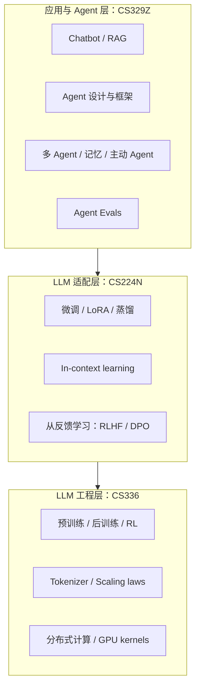
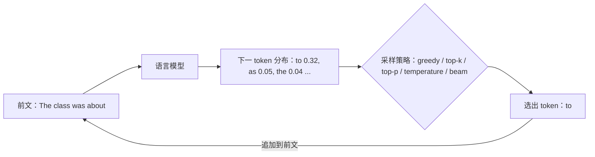
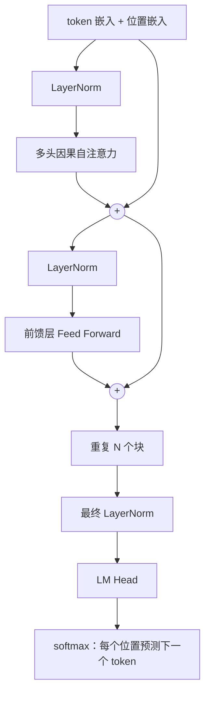
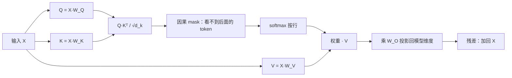
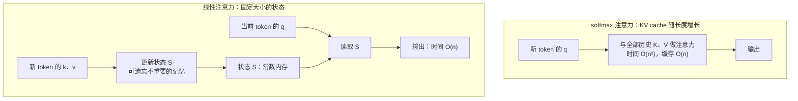
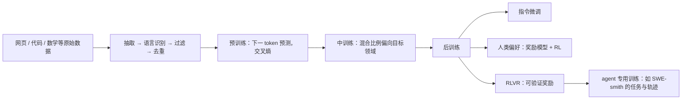
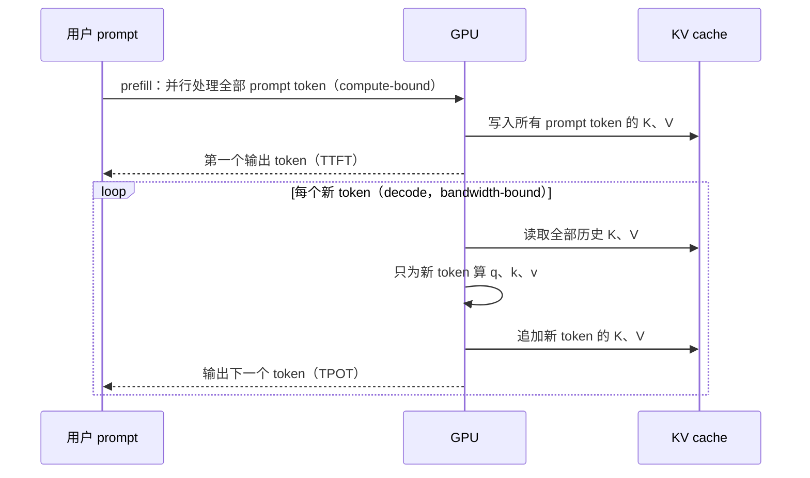
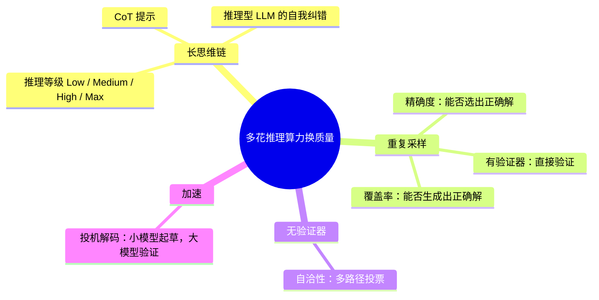
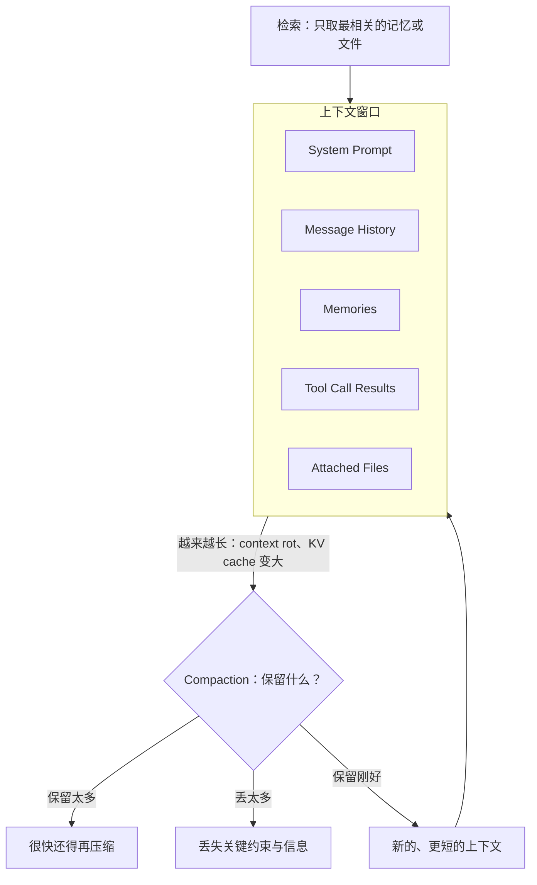

# L02 LLMs for Builders

> 本页是个人学习笔记：用自己的话复述并整理，不复制课件图片。对应课件共 176 页（其中很多页是同一张图的逐步动画，下文按页码范围合并描述），文中的 “p.N” 指课件页码。课件之外的补充会标（补充）；课件与原始来源对不上的地方会标 “⚠ 不一致”。

## 概览

**一句话**：这一讲给 agent 的 builder 讲 LLM 的内部：语言模型 = 对 token 序列的概率分布，Transformer 靠注意力在 O(n²) 的代价下换来可并行训练，线性注意力用固定大小的状态换来 O(n) 却更难处理长上下文；训练分预训练、中训练、后训练；推理分 prefill 与 decode，靠 KV cache 和推理时扩展（test-time scaling）换质量；最后落回 agent：结构化 I/O 和 context engineering。

**定位（p.2–4）**：课件用一张 “LLM Stack” 图说明本课的位置。

- 最底层是 LLM 工程（分布式计算、GPU kernels、scaling laws、预训练、后训练、tokenizer），对应 CS336。
- 中间是 LLM 适配（微调、蒸馏、LoRA、in-context learning、从反馈学习如 RLHF / DPO），对应 CS224N。
- 最上层是应用与 agent（chatbot、RAG、agent 设计、多 agent、记忆、主动 agent、agent evals、框架），**CS329Z 在这一层**。
- p.3 的态度：我们在栈的最高层工作，但仍然有必要知道模型怎么工作的。

**学习目标（p.4）**：

1. 理解并解释训练与推理现代 LLM 的核心设计决策。
2. 综合这些设计决策怎样产生限制，从而影响应用使用 LLM 的方式。

**本讲结构（p.5，课件在 p.6、p.24、p.92、p.119、p.149、p.174 用同一条导航栏重复）**

| 板块 | 内容 | 课件页 |
| --- | --- | --- |
| 什么是语言模型 | 序列概率、生成式 vs 判别式、采样与解码策略 | p.6–23 |
| 语言模型架构 | Transformer、注意力、线性注意力、混合注意力 | p.24–91 |
| 训练 | 损失、预训练、中训练、后训练、agent 专用训练 | p.92–118 |
| 推理 | prefill / decode、roofline、KV cache、投机解码、推理时扩展 | p.119–148 |
| LLMs for Agents | 结构化 I/O、context engineering | p.149–173 |
| 总结 | | p.174–176 |

**读完你应该能回答**：

1. 语言模型到底在算什么？为什么说它是 “生成式” 的？
2. 注意力的一次前向里，Q、K、V、mask、softmax 各自做什么？为什么长上下文贵？
3. 线性注意力用什么换掉了什么？为什么实际模型要把两种注意力混着用？
4. 预训练、中训练、后训练各自改变了什么？RLVR 为什么适合数学和代码？
5. prefill 与 decode 的瓶颈为什么不一样？KV cache 怎样影响你写 agent 的方式？
6. 往 agent 的上下文里塞东西有哪些原则？

## 核心概念

| 概念 | 一句话解释 | 课件页 |
| --- | --- | --- |
| Language model | 对 token 序列联合概率建模：逐 token 的条件概率连乘 | p.7–8 |
| Generative vs discriminative | 学数据分布 vs 学类别边界；语言模型是生成式的 | p.10–13 |
| Sampling / decoding | 从下一 token 分布里选 token 的策略：greedy、top-k、nucleus、temperature、beam | p.14–22 |
| Decoder-only Transformer | 嵌入 + 位置信息，经 N 个（注意力 + 前馈）块，再接 LM head 与 softmax | p.28–60 |
| Self-attention | 每个 token 用 Q 去匹配所有（因果 mask 内的）K，按权重汇总 V | p.32–43 |
| Multi-head attention | 多组 W_Q / W_K / W_V，拼接后用 W_O 投影回模型维度 | p.44–48 |
| Linear attention | 去掉 softmax，改变结合顺序，用固定大小的状态 S 递推 | p.63–83 |
| Hybrid attention | 全局 softmax 注意力与线性注意力混合使用 | p.88–90 |
| Cross-entropy loss | 对真实下一 token 取 −log 概率，对词表求和 | p.93–100 |
| Pretraining / midtraining / posttraining | 通用数据 → 偏向目标领域的数据 → 指令 / 偏好 / 可验证奖励 | p.101–118 |
| RLVR | 用可程序化验证的奖励（单测、证明、精确匹配、系统状态）做强化学习 | p.116 |
| Prefill / decode | 一次性并行处理 prompt / 逐 token 生成 | p.119–133 |
| KV cache | 缓存历史 token 的 K、V，避免重算 | p.133 |
| Roofline model | 用算术强度判断瓶颈在带宽还是算力 | p.122、p.134 |
| Speculative decoding | 小模型起草、大模型并行验证 | p.136–137 |
| Test-time scaling | 多花推理算力换质量：长 CoT、推理等级、重复采样、自洽性 | p.138–148 |
| Structured I/O / constrained decoding | 约束模型输出格式，让系统组件之间有 “共同契约” | p.152–159 |
| Context engineering | 决定什么放进上下文、按什么顺序、何时压缩 | p.160–173 |
| Context rot | 上下文越长，模型对其中信息的利用越差 | p.163–165 |
| Compaction | 上下文太长时重写 / 压缩，决定保留什么 | p.171 |
| Recursive LMs（RLM） | 让模型把长上下文当作环境，用代码和子调用去处理 | p.172–173 |

## 详细笔记

### 1. 开场：LLM 栈与本讲目标（p.1–5）

见概览。要点只有一个：**这门课在 LLM 栈的最高层，但 agent 的设计受下层的限制**。后面几乎每一节的结尾都会回到 “这对 agent builder 意味着什么”。

### 2. 什么是语言模型（p.6–23）

**2.1 定义（p.7–9）**

- p.7：一个 token 序列的概率，等于**从第一个 token 到最后一个 token，每个 token 在给定它前面所有 token 条件下的概率的乘积**。
- p.8 的例子：句子 “The class was about agents .”。依次是 P(The)=0.0377，P(class | The)=0.0001，P(was | The, class)=0.0344，……，最后 P(. | The, class, was, about, agents)=0.0252，整句概率（连乘）约 1.2e-17。
- 页脚提醒：**实践中通常对概率取对数后求和**，以保证数值稳定（连乘会下溢）。
- p.9：“这就是一个语言模型”。

**2.2 生成式 vs 判别式（p.10–13）**

- 判别式：学习区分类别（逻辑回归、SVM）；生成式：学习数据的分布（朴素贝叶斯、扩散模型）。
- p.12 的 “知识检查”：把序列概率写成上面的连乘，它是生成式还是判别式？课件说这不是脑筋急转弯，只是记号容易让人糊涂。p.13 给出答案：**LM 是生成式的，所以可以从它采样**。（补充：条件概率 P(x_t | x_<t) 看起来像分类器，但分类的对象是 “下一个 token”，把所有位置连乘起来就是整个序列的联合分布。）

**2.3 采样（p.14–19）**

- p.15–17：给定前文 “The class was about”，模型对下一个 token 给出一个分布：to 0.3171、as 0.0491、the 0.036、a 0.033、two 0.0147、how 0.0124、getting 0.0101、three 0.01、time 0.0091、“ 0.0081……
- p.18：接着 “about to” 之后的分布：be 0.1501、begin 0.0855、go 0.0627、start 0.0496……  课件强调：**我们不一定要选概率最高的 token**，有不同的采样（解码）策略：greedy、nucleus（top-p）、top-k 等。
- p.19：最终生成 “The class was about to begin .”，说明一个句子就是一连串 “看分布 → 选 token → 接到前文” 的循环。

**2.4 Temperature 与 Beam Search（p.20–22）**

- p.20 Temperature：课件的说法是 “把所有概率除以温度 T，再重新归一化”。图中展示了 T 取不同值时分布从尖锐到平坦。
  - ⚠ **不一致**：严格地说，温度是**除 logits**（softmax 之前的分数），等价于把概率取 1/T 次幂再归一化；“概率除以 T 再归一化” 会因为归一化而变成什么都没做。图和结论（T 小更尖锐、T 大更平坦、更多样）没有问题，只是文字不精确。
- p.21 Beam Search：同时保留若干条得分最高的候选序列，逐步扩展；图为搜索树。
- p.22 取舍：
  - 每种策略都有取舍；temperature 与 top-p / top-k 帮助多样性。
  - 数学、代码更可预测，适合更低温度；创意写作可从更高多样性受益。
  - 预算也影响选择：beam search 的时间和内存复杂度更高。
- p.23 延伸阅读：Hugging Face 的 *Decoding Strategies in Large Language Models*、Tokenizers 一章、Generative Models 讲义（链接见文末）。
- （补充）top-k 只在概率最高的 k 个 token 里采样；top-p（nucleus）在累计概率刚好超过 p 的最小集合里采样；greedy 等价于 T→0。

### 3. 语言模型架构（p.24–91）

**3.1 简史（p.25–27）**

- n-gram 模型（2010 年代之前）→ 第一个神经语言模型（2003）→ RNN 语言模型（2010）→ LSTM（1997 发明，2014 年左右在语言模型里普及）→ Transformer。
- p.26：Transformer 的整体示意（图来自 Songlin Yang 的 *DeltaNet Explained (Part III)*）。
- p.27：*Attention Is All You Need*（2017）。原论文是编码器 + 解码器结构；**现代 LLM 基本只用解码器那一半**（decoder-only），这是后面的主角。

**3.2 Decoder-only Transformer：从输入到嵌入（p.28–31）**

- 每个输入 token 先变成嵌入向量，再**加上位置嵌入**（positional embedding），得到每个位置的输入向量。图中用 “The class was about” 作例子，p.28–31 是逐步动画。
- p.32 警告：“**这里要认真看！如果这里没跟上，后面大半讲都会很难懂**”。

**3.3 注意力：一次前向（p.33–43）**

课件用 p.33–43 的逐步动画展示一个注意力层。我把它整理成下面的步骤（`X` 是 n×d 的输入矩阵，每行是一个 token）：

1. **LayerNorm**：先对输入做层归一化（课件画的是先归一化再进注意力，即 pre-norm；（补充）2017 年原版是 post-norm）。
2. **乘三个权重矩阵得到 Q、K、V**：`Q = X·W_Q`，`K = X·W_K`，`V = X·W_V`（p.35）。
3. **Q 乘 K 的转置**：得到 n×n 的分数矩阵，每个元素表示 “第 i 个 token 对第 j 个 token 的关注程度”。
4. **缩放**：除以 √d_k（p.41 的公式里是 ÷）。
5. **因果 mask**（causal attention mask，p.37）：一个 token **不能看到它后面的 token**，把上三角置为负无穷。这是 decoder-only 能做 “逐 token 生成” 的前提。
6. **softmax**（按行）：把分数变成权重。
7. **乘 V**：用权重对所有 token 的 V 加权求和，得到每个 token 的新表示。
8. **乘 W_O**：投影回模型维度（p.41）。
9. **残差连接**：把输出加回输入 X（p.42）。

用一个公式表示（补充，标准写法）：

```text
Attention(Q, K, V) = softmax( (Q·Kᵀ) / √d_k + mask ) · V
```

**3.4 多头注意力（p.43–48）**

课件分三步（p.44、p.46、p.47）：

1. **多组权重矩阵**：每个 “头” 有自己的 W_Q、W_K、W_V，各自算一遍注意力。
2. **拼接**各头的输出。
3. 用一个**更大的投影矩阵 W_O** 把拼接结果投影回模型维度。

直观理解（补充）：不同的头可以关注不同类型的关系（语法、指代、位置等），拼起来后信息比单头更丰富。

**3.5 组装成完整的 decoder-only 模型（p.49–60）**

- p.54：一个 Transformer 块 = **LayerNorm → 多头因果自注意力 → 残差相加 → LayerNorm → 前馈层（Feed Forward）→ 残差相加**。
- p.55–59：把这个块堆叠 **N 次**；最上面接一个**最终的 LayerNorm 和 LM Head**（把隐状态映射成词表大小的分数），再接 softmax 得到下一个 token 的分布（p.59）。
- p.60：**每个位置都会输出一个 softmax**，即每个位置都在预测它的下一个 token。这就是训练时能并行的原因：一次前向就得到序列里所有位置的预测。

**3.6 注意力 vs 递归（p.61–62）**

p.61 引用原论文的表 1（每层复杂度、顺序操作数、最大路径长度）：

| 层类型 | 每层复杂度 | 顺序操作数 | 最大路径长度 |
| --- | --- | --- | --- |
| 自注意力 | O(n²·d) | O(1) | O(1) |
| 循环 | O(n·d²) | O(n) | O(n) |
| 卷积 | O(k·n·d²) | O(1) | O(log_k n) |
| 自注意力（受限） | O(r·n·d) | O(1) | O(n/r) |

课件的两条结论：

- **O(1) 的顺序操作数对 GPU 并行训练意义重大**。RNN 必须一个 token 一个 token 地算，Transformer 可以一次算完整个序列。
- **O(n²) 的序列长度意味着长上下文变得昂贵**。

p.62：论文里 Transformer 在翻译任务上**更好也更便宜**：base 模型 BLEU 27.3（EN-DE）/ 38.1（EN-FR），训练成本约 3.3·10¹⁸ FLOPs；big 模型 28.4 / 41.8，约 2.3·10¹⁹ FLOPs，而对比的 ConvS2S 集成模型训练成本高出一到两个数量级（数字取自课件所示的原论文表，以原文为准）。

**3.7 线性注意力（p.63–83）**

课件用一长串动画推导。思路如下：

1. **去掉 softmax**（p.67 “Drop Softmax”）。一旦去掉，注意力里的运算全是线性的。
2. 线性运算可以**改变结合顺序**：原来是 `(Q·Kᵀ)·V`，先得到 n×n 的矩阵；现在改成 `Q·(Kᵀ·V)`，**先把 K 和 V 乘起来**（p.67）。`Kᵀ·V` 是一个与序列长度无关的 d×d 矩阵。
3. 把 `Kᵀ·V` 看作一个**状态 S**（p.69）。每来一个新 token，就用它的 k、v 去**更新状态**（p.71 “Update Rule”），然后用当前 token 的 q 去**读取状态**得到输出。
4. p.73：更新规则里可以**清除不重要的记忆**（“Clear Unimportant Memory”）；p.74：保存新的状态。
5. p.75–82：逐个 token 重复这个过程：S1 → S2 → S3 → S4。每一步只依赖前一个状态和当前 token。

（补充）最朴素的线性注意力递推是 `S_t = S_{t-1} + v_t·k_tᵀ`，`o_t = S_t·q_t`；课件所画的 “清除不重要记忆” 对应带遗忘 / delta 规则的变体，如 DeltaNet 的 `S_t = S_{t-1}(I − β_t·k_t·k_tᵀ) + β_t·v_t·k_tᵀ`。

p.83：**线性注意力快得多，内存占用更好**。图来自 *Transformers are RNNs*：随序列长度增长，softmax 注意力的时间和显存按平方增长，线性注意力按线性增长，Reformer 变体居中。

p.84：**但它在更长的上下文上更吃力**。图来自 RULER：在单针、多键、多值 NIAH（大海捞针）类任务上，随序列长度从 1k 到 8k，Llama2-7B（softmax 注意力）、RWKV-v5-7B（线性 / 递归）、Mamba-2.8B 的准确率都下降，后两者掉得更早更快（具体数字以原图为准）。

p.85 “关于上下文长度的说明”：**无论 Transformer 还是线性注意力，本身都没有强制的上下文长度上限**，真正的限制来自位置嵌入。实践中模型必须学会使用位置嵌入，所以**能用的长度被训练时见过的长度所限制**。

- ⚠ **不一致 / 需要注意**：p.84 的标题把长上下文退化归因于线性注意力，但同一张图里的 softmax 基线 Llama2-7B 在 8k（超出它 4k 的训练长度）也几乎崩掉。所以这张图其实同时展示了两件事：线性 / 递归结构更早退化，以及**任何模型超出训练长度都会退化**（p.85 的内容）。读图时不要把它简化成 “线性注意力不行”。

**3.8 对比与混合（p.86–90）**

p.87 的对比表：

| | 全 softmax 注意力 | 线性注意力 |
| --- | --- | --- |
| 复杂度 | 对上下文长度 O(n²) | 对上下文长度 O(n) |
| token 之间 | 所有 token 都能回看所有前面的 token | 新 token 只和一个**压缩后的状态**交互 |
| 长上下文 | 有帮助 | 更难 |
| 内存 | KV cache 随长度 O(n) 增长 | 状态使用**常数**内存 |

p.88–89：**实践中大家把全局注意力和线性注意力混用**。图展示了 DeltaNet 的混合层（交替使用滑动窗口注意力 SWA / DeltaNet 层，并插入全局注意力层）。p.89 的表（DeltaNet Explained 里的实验）：

| 模型 | Wiki. ppl（越低越好） | 平均常识准确率 | 平均检索准确率 |
| --- | --- | --- | --- |
| DeltaNet | 28.24 | 42.1 | 22.7 |
| + Sliding Attn | 27.06 | 42.1 | 30.2 |
| + Global Attn | 27.51 | 42.1 | 32.7 |

读法：常识能力基本不变，**检索能力随混入注意力明显提升**（22.7 → 30.2 / 32.7）；这正是线性层的弱项。

p.90：**Kimi K3** 的架构图（论文 *Kimi K3: Open Frontier Intelligence*，arXiv 2607.24653）：课件圈出了前馈层、多头（潜在）注意力和线性注意力三种模块，说明前沿开源模型确实在混用。

**3.9 这些对 agent 为什么重要（p.91）**

- agent 可能要处理**极长的上下文**。
- **推理效率是搭建 agent 系统的设计考量**。
- 了解底层模型架构，能帮你**为 agent 应用选对模型**。
- 围绕你所用模型的**强项与弱项**去开发 harness 和脚手架，会让你成为更好的 agent 工程师。

### 4. 训练（p.92–118）

**4.1 损失函数（p.93–100）**

- p.94：训练数据示例：一段文本 “The class was about how agents work, and how to build AI systems that use tools, retrieve information, and carry out tasks across multiple steps…”。
- p.96–98：把前缀 “The class was about” 喂给模型，得到下一个 token 的分布；**真实数据里的下一个 token 是 “how”**，模型给它的概率只有 0.0124。
- p.99：损失 = −log(0.0124) = 1.907。
  - ⚠ **不一致**：−log(0.0124) 用自然对数是 **4.39**；1.907 对应的是**以 10 为底**的对数（−log₁₀0.0124 ≈ 1.907）。训练中通常用自然对数，课件这里的数值是 log₁₀。结论（概率越低损失越大）不受影响。
- p.100 交叉熵：对词表里的每个 token，乘上一个指示量（**当该 token 是数据里的真实 token 时为 1，否则为 0**）与该 token 的对数概率，再取负并求和。因为只有真实 token 项非零，所以就是 −log P(真实 token)。（对序列里每个位置求平均，就是语言模型的训练损失。）

**4.2 预训练（p.101–107）**

- p.102 数据处理流水线：HTML → **文本抽取** → **语言识别** → **规则过滤** → **质量过滤** → **去重** → 最终训练数据。
- p.103：DCLM-Baseline 的构建（DataComp-LM，arXiv 2406.11794）：先启发式清洗（去掉重复、页面长度、其他过滤器等），再去重，最后是**基于模型的过滤**，每一步都会剔除大量文档。
- p.104：Nemotron-CC-Math（arXiv 2508.15096）：从 Common Crawl 里挑出数学页面，用 Lynx 渲染、LLM 处理清洗，再去重去污染，得到一个 1330 亿 token 量级的数学预训练数据集。
- p.105：DCLM 里的数据样例。展示了原始网页文本有多杂：论坛帖、Fortran 文档、烹饪学校的新闻、被广告和导航打断的段落。意思是**预训练数据本质上是被大量过滤后的网络垃圾堆里挑出来的**。
- p.106：The Pile（800GB 多样化文本，arXiv 2101.00027）的组成：数据由多个领域的来源混合而成。
- p.107：**数据混合**（Olmix，arXiv 2602.12237）：用 “蜂群 swarm（训练许多小代理模型）→ 回归（预测混合比例对性能的影响）→ 优化（在约束下最小化预测损失）” 三步来找各来源的混合比例。

**4.3 中训练（p.108–111）**

- p.109：**把数据混合调得更偏向目标领域（数学、代码等）**。图来自 openathena.ai 的 *Curating 25 Trillion Tokens for LLM Pretraining*，展示按质量分档（Q1–Q5）与 “冷却（cooldown）” 阶段在不同领域的混合。
- p.110：**把更多目标领域的数据混进 “预训练”，往往有帮助**。图来自 *The Finetuner's Fallacy: When to Pretrain with Your Finetuning Data*（arXiv 2603.16177）：在通用数据里掺入目标领域数据的重复，比只在后面微调，在领域内泛化更好，同时少忘一点通用能力（课件图上写的是 “mix 10–50× domain repeats”，具体设定以原论文为准）。
- p.111：*Midtraining Bridges Pretraining and Posttraining Distributions*（arXiv 2510.14865）：示意图说明，中训练让模型沿一条更平滑的路径从预训练分布走向后训练分布（图中标注为 schematic，示意性质）。

**4.4 后训练（p.112–118）**

- **指令微调（p.113）**：Flan（*Scaling Instruction-Finetuned Language Models*，arXiv 2210.11416）：用多任务的指令数据（含思维链样例）微调，让模型能泛化到没见过的指令。
- **从人类偏好学习（p.114）**：InstructGPT（arXiv 2203.02155）的三步：先用示范数据做监督微调；再让标注者对多个输出排序，训练奖励模型；最后用奖励模型通过强化学习（PPO）优化策略。
- **人类反馈的问题（p.115）**：
  - 标注者可能不可靠。
  - 每个人的偏好不同。
  - 会带来糟糕的优化激励（谄媚、故作权威）。
  - 数据本身可能来源不道德。
  - （课件注明这页的灵感来自 CS329X。）
- **RLVR：带可验证奖励的强化学习（p.116）**：
  - 把奖励做成**可验证**的：单元测试、Lean 证明、精确匹配、系统状态……
  - 对数学和代码特别好。
  - 但要**小心验证器的设计**（验证器被钻空子，奖励就失真）。
  - 配图是 DeepSeekMath 的 GRPO 流程（策略模型、参考模型、奖励模型、组内计算优势）。
- **agent 专用训练：SWE-smith（p.117–118，arXiv 2504.21798）**：
  - 流程：真实代码仓库 → **构造环境**（用 SWE-agent 尝试安装并跑测试，Developer 写 Dockerfile）→ **任务生成策略**（程序化修改、LM 生成、合并 bug、PR 镜像）→ **得到新任务实例**（环境镜像、合成任务、生成的 issue、带 bug 的补丁、验证用测试）。
  - p.118 表：SWE-agent-LM-7B 用 2k 条轨迹训练，在 SWE-bench Lite / Verified 上约 11.7 / 15.2；SWE-agent-LM-32B 用 5k 条轨迹，约 **30.7 / 40.2**，是表里开源权重模型的最好成绩（闭源的 Claude 3.7 Sonnet + SWE-agent 为 48.0 / 58.2）。
  - 含义：**任务和环境的构造方式本身就是 agent 训练的关键**，这是第 11–12 讲的预告。

### 5. 推理（p.119–148）

**5.1 GPU 与 roofline（p.120–122）**

- p.121：CPU 与 GPU 的对比：GPU 用大量简单的计算单元（ALU）换并行度，访问显存（DRAM）。
- p.122：**Roofline 性能模型**：横轴是算术强度（每字节数据要做多少浮点运算），纵轴是可达到的 FLOP/s。左边斜线部分受**显存带宽**限制（bandwidth-bound），右边水平线部分受**峰值算力**限制（compute-bound）。

**5.2 Prefill 与 Decode（p.123–135）**

- p.123：生成分两个阶段：**prefill** 一次性处理整个 prompt，算出所有 prompt token 的 KV 向量并缓存（图中标 cached）；**decode** 之后每步只生成一个 token，再复用缓存。
- p.124–125：prefill 时，所有 prompt token 一起做注意力，矩阵乘法大，GPU 吃得饱。
- p.126–132：decode 时每步只有一个新 token：算出它的 q、k、v，新的 k、v 追加进缓存，q 去和所有缓存的 K 做注意力。
- p.133：**KV cache**：历史 token 的 K 与 V 被缓存，不重算。（补充：缓存大小 ≈ 2 × 层数 × KV 头数 × 头维度 × 每个数的字节数 × token 数。）
- p.134：把两阶段放到 roofline 上：**prefill 在 compute-bound 区**（算术强度高），**decode 在 bandwidth-bound 区**（每步要把整个模型权重和 KV cache 从显存读一遍，却只做很少的计算）。
- p.135 指标：**time to first token（TTFT）** 对应 prefill；**time per output token（TPOT）** 对应 decode。

**5.3 投机解码（p.136–137）**

- p.136：小的 **draft model** 先快速起草几个 token（图中是 “upon a time there”），**target model 一次并行验证**这些 token；前面几个被接受（✓），第一个不一致的被拒绝（✗），其后的丢弃，再从那里继续。
- 好处：最终输出分布与只用大模型一致（补充：这是论文的结论），但每一次大模型前向可以确认多个 token，缩短延迟。
- p.137：**有些领域比其他领域更可预测**。图来自 *Accelerating Large Language Model Decoding with Speculative Sampling*（arXiv 2302.01318）：不同任务下的采样时间、接受率、总时间随草稿长度 K 变化，代码类任务（HumanEval）的接受率高于摘要类（XSum）。

**5.4 推理时扩展（p.138–148）**

- p.139 **Chain of Thought**（arXiv 2201.11903）：标准提示直接答错，CoT 提示让模型先写推理步骤，再答对。
- p.140 **推理型 LLM**：以 “夹克先涨价 25% 再打 75 折” 为例，传统 LLM 直接按步骤算出 $75；推理型 LLM 会先想 “加 25% 再减 25% 似乎抵消，最终 $80”，然后说 “Wait… 这要求两者用同一基数”，重新计算并检查 $80 + $20 − $25 = $75。重点是**模型学会了自我纠错（“Aha” 时刻）**。
- p.141：另一个 “Aha moments” 例子（图来自 Sebastian Raschka 的文章）：在答案过程中，模型注意到 “Wait, that can’t be right”，回头改正。
- p.142–143 **推理等级**：同一个模型可以设 Low / Medium / High / Max，花的推理 token 越多，分数越高、成本越高（图来自 OpenAI 的 GPT-6 Sol / Luna 发布页，该链接对自动检查返回 403，我没能核对原文）。**GPT-OSS** 通过 system prompt 里的 `Reasoning: low / medium / high` 设定。
- p.144 **怎么训出可调的推理力度**：
  - **Inkling（Thinking Machines）**：奖励 R(e) = R_task − λ(e)·N_tokens；**想让低力度时 λ 设大，想让高力度时 λ 设小**，即对用掉的 token 数做惩罚。
  - **Kimi K3（Moonshot）**：奖励是 1（答对）、0（答错）、−1（答错且超出预算）；并用**多教师蒸馏**：通用任务 / 通用 agent / coding agent 三类任务，各有高 / 中 / 低力度三位教师，蒸馏到一个学生模型。
- p.145–146 **重复采样扩展**（*Large Language Monkeys*，arXiv 2407.21787）：第一步生成大量候选解，第二步用**验证器**选出最终答案。有两个问题：**覆盖率**（能不能生成出一个正确解？）和**精确度**（能不能从样本里选出正确的？）。图显示在 MiniF2F-MATH、CodeContests、MATH、GSM8K 上，**覆盖率随样本数（对数轴）持续上升**。
- p.147–148 **没有验证器怎么办？自洽性（Self-Consistency）**（arXiv 2203.11171）：生成多条推理路径，对最终答案**边缘化（投票）**。图（ARC Challenge）：自洽（多路径）的准确率随采样路径数增加而上升，约从 35 升到 53；“采样后排序（Sample & Rank）” 约从 35 升到 44，“贪心解码（单路径）” 约 43，两者增长都远不如自洽性（数字为读图估计，以原图为准）。

### 6. LLMs for Agents（p.149–173）

**6.1 结构化 I/O（p.150–159）**

- p.152 **为什么要结构化 I/O**：compound AI 系统里的各个组件需要一个**共享的契约**来约定怎样通信（配图来自 BAIR 的 compound AI 博客）。
- p.154 **约束解码（constrained decoding）**：强制语言模型输出某种特定结构。例子里 **SGLang 用有限状态机来做解码**（以及其他优化）；图比较了 SGLang、vLLM、Guidance、LMQL 在不同工作负载上的归一化吞吐（Llama-7B）。
- p.155–156 **DSPy Signatures**：在代码里声明输入输出字段与类型，如 `message -> name, email, intent`（intent 是 Literal['meeting', 'intro', 'follow-up']）。p.156 “窥探内部”：DSPy 把它展开成一个带字段标记（`[[ ## name ## ]]` 这类）的 system prompt，要求模型严格按字段输出，并说明每个字段的类型和取值范围。意思是：**签名是对 “模型输出格式” 的声明，由框架翻译成 prompt**。
- p.157 **约束模型：分类器**：在嵌入之上训练一个小头，映射到类别标签（图来自 BERT 可视化指南）。
- p.158 **约束模型：System One 模型**：当下流行的叫法，大致是 “带可适配选项的分类器”（用于 “决策”）。
- p.159 **例：工具调用**：Toolformer 的例子，在文本中插入 API 调用并带回结果。结构化输出是工具调用的基础。

**6.2 Context Engineering（p.160–173）**

- p.161：来自 Anthropic 的图，对比 “prompt engineering（单次查询）” 和 “context engineering（agent）”：agent 的上下文会不断由系统提示、工具、记忆、外部数据、消息历史等组装。
- p.162 **agent 上下文里有什么**：System Prompt、Message History、Memories、Tool Call Results、Attached Files。
- p.163–164 **为什么不把所有东西都放进去？Context Rot（上下文腐烂）**：图来自 OOLONG（arXiv 2511.02817）：随上下文长度（8K 到 512K）增长，各模型在长上下文推理与聚合任务（OOLONG-synth、OOLONG-real）上的分数**持续下降**。
- p.165：**没有唯一正确的上下文构造方法**，需要实验，HW1 里会动手；课件接着给出一些**实用建议**：
  - **避免臃肿（p.166）**：有时几个工具就够了。Pi 只有 read、write、edit、bash 四个工具。图来自 Arena 的 *HarnessTax*：在 Terminal-Bench 2 上同一模型换不同 harness（Pi、Codex、Claude Code），成功率和单次成本都有差异，轻量的 Pi 并不吃亏（具体数字低分辨率下读不清，请看原文）。
  - **用检索取回最相关的记忆或文件（p.167）**：配图是检索流程（嵌入模型 → 向量库搜索 → 重排序 → LLM），下一讲（RAG）展开。
  - **顺序追加，避免让 KV cache 失效（p.168–169）**：在上下文中间插入内容，会让之后所有 token 的位置嵌入都变了，**KV cache 作废**，要重算。所以应尽量往末尾追加，而不是改前面。
  - **用实证来评估上下文选择（p.170）**：设好 benchmark / evals，测试每次改动。
    - ⚠ **注意**：这页配的是 Toolformer 的模型规模对比图（有无工具），更像 “做消融并测量” 的示意，而不是对 context 构造的直接实验。
  - **Compaction（压缩，p.171）**：到压缩的时候上下文已经极长；**新的决定是保留什么**。保留太多，很快还得再压缩；丢太多，会丢掉完成任务所需的关键上下文。课件配了一条社交媒体帖子作例子：据称某 agent 在收件箱很大时触发了自动压缩，丢失了 “行动前先确认” 的指令，之后开始删邮件。**这是转述的网络传闻，我没有核实**，只当作 “压缩会丢失约束” 的警示。
- **另一种思路：Recursive LMs（RLM，p.172–173，arXiv 2512.24601）**：不是把长上下文塞进窗口，而是把它放在一个**环境**中（课件图里是带 REPL 的环境；（补充）论文做法是把长 prompt 存成代码环境里的变量），让模型写代码去检查、切分、并递归调用子 LM 处理片段，最后汇总。p.173 的图（OOLONG trec_coarse，263k token 上下文，得分）：GPT-5 34.2、GPT-5-mini 23.2、**RLM(GPT-5-mini) 51.1**、RLM(GPT-5) 去掉子调用 40.9、ReAct + GPT-5 + BM25 30.7。含义：同样的底座模型，换一种上下文组织方式，分数差很多。

### 7. 总结（p.174–176）

课件的总结清单：

- 什么是语言模型
- 语言模型架构（Transformer、线性注意力）
- 语言模型训练（预训练、中训练、后训练、agent 训练）
- 语言模型推理（prefill / decode、推理时扩展）
- LLMs for Agents（结构化 I/O、context engineering）

p.176：“周三见，讲 RAG！”（对应本站的 [L03](./lecture-03.md)）。

## 关键图示

以下图示是根据课件内容**自行重画**的 Mermaid 示意，不是课件原图。

### 图 1　本课在 LLM 栈中的位置（p.2）



### 图 2　自回归生成循环与采样（p.14–19）



### 图 3　一个 decoder-only Transformer 块与整体（p.54–60）



### 图 4　单头注意力的计算流程（p.33–43）



### 图 5　softmax 注意力与线性注意力（p.63–87）



### 图 6　训练流水线（p.92–118）



### 图 7　Prefill 与 Decode（p.119–135）



### 图 8　推理时扩展的几种做法（p.138–148）



### 图 9　agent 的上下文与 Compaction（p.160–171）



## 重点 / 易错点

1. **语言模型算的是联合概率的连乘**，实现上用对数求和。生成时每一步只是 “看分布，选一个 token”。
2. **温度除的是 logits，不是概率**（课件文字不精确，见上）。T 小更确定，T 大更发散；代码、数学倾向低温。
3. **注意力的三个矩阵各管一件事**：Q 是 “我在找什么”，K 是 “我有什么标签”，V 是 “我携带的内容”（补充的直观说法）。mask 保证只看过去。
4. **O(n²) 的是时间，KV cache 的是显存**：全注意力的注意力计算是平方，缓存大小与长度成正比。不要把两者混为一谈。
5. **线性注意力不是 “无损加速”**：它把全部历史压进固定大小的状态，**检索类任务（大海捞针）会受损**；这就是模型要混入全局注意力的原因。
6. **上下文长度的真正上限来自训练长度（位置嵌入）**，不是结构本身。超出训练长度，任何模型都会退化。
7. **损失里的 log 底数**：课件的 1.907 是 log₁₀ 的结果，用自然对数是 4.39。
8. **预训练数据要重过滤**：原始网页文本很脏，过滤和去重是效果的主要来源之一，不是可有可无的步骤。
9. **RLVR 的前提是验证器可靠**：奖励可被钻空子，训练出来的模型就会钻空子。
10. **prefill 是算力瓶颈，decode 是带宽瓶颈**：所以长 prompt 的首 token 慢，长输出的总时间慢，是两个不同的问题，优化手段也不同。
11. **往上下文中间改内容会让 KV cache 失效**：agent 的 prompt 应尽量只在末尾追加，稳定的 system prompt 放前面。
12. **“塞得下” ≠ “用得好”**（context rot）：长上下文的成本、精度都会变差，要用检索、压缩或递归的方法组织上下文。
13. **压缩会丢约束**：compaction 时最容易丢掉的往往是那些 “只说了一次” 的规则，比如要确认再行动。关键约束要放在不会被压缩掉的位置。

## 讨论与思考题

1. 用你自己的话讲清楚：为什么 “LM 是生成式的” 这句话成立？如果把它当作分类器（下一个 token 是哪一类），会漏掉什么？
2. 写出一次因果自注意力的完整步骤，并回答：去掉 mask 之后训练和推理分别会出什么问题？
3. 假设一个模型有 32 层、8 个 KV 头、头维度 128，KV 用 fp16 存储。每个 token 的 KV cache 是多少字节？100k token 的上下文需要多少显存？（提示：2 × 层数 × KV 头数 × 头维度 × 2 字节 = 131072 字节 ≈ 128 KiB/token，100k token ≈ 12.2 GiB。）这对同时服务多个长上下文 agent 意味着什么？
4. 线性注意力的状态大小固定。如果任务需要在 100k token 之前精确找回一个数字，它会遇到什么困难？混合模型用什么办法补救？p.89 的表里哪一列体现了这一点？
5. 课件说 “推理效率是设计 agent 系统的考量”。请你列出三个会直接影响 agent 延迟与成本的设计决策（例如 prompt 前缀是否稳定、工具结果长度、是否开推理）。
6. RLVR 的验证器可以是单测、精确匹配、系统状态。你的 agent 任务里，哪些可以写成这样的验证器，哪些只能用 LLM 判官？这个划分和第 13、15 讲的评测有什么关系？
7. 重复采样的 “覆盖率” 与 “精确度” 分别由什么决定？没有验证器时，自洽性适用于哪些任务、不适用于哪些任务（比如开放式生成）？
8. 设计一个 compaction 策略：哪些信息必须永远保留？如何检测压缩后丢失了关键约束？（可与 [L01](./lecture-01.md) 的 “长程任务里上下文漂移” 对照。）
9. 把 p.171 那个 “压缩后丢掉确认指令” 的例子当作真实风险：你会在 harness 层做什么，让安全约束不依赖模型 “记得”？

## 延伸阅读与资源

**官方指定阅读（官网第 2 周，9/28）**

- Vaswani et al. *Attention Is All You Need*. NeurIPS (2017). [arXiv:1706.03762](https://arxiv.org/abs/1706.03762)
- Katharopoulos et al. *Transformers are RNNs: Fast Autoregressive Transformers with Linear Attention*. ICML (2020). [arXiv:2006.16236](https://arxiv.org/abs/2006.16236)
- Rajasekaran et al. *Effective Context Engineering for AI Agents*. Anthropic (2025). [文章](https://www.anthropic.com/engineering/effective-context-engineering-for-ai-agents)

**课件 “Further Reading”（p.23）**

- [Decoding Strategies in Large Language Models](https://huggingface.co/blog/mlabonne/decoding-strategies)
- [Hugging Face LLM Course：Tokenizers](https://huggingface.co/learn/llm-course/en/chapter2/4)
- [Stanford CS236 Generative Models 讲义：Introduction](https://deepgenerativemodels.github.io/notes/introduction/)

**架构**

- Songlin Yang. *DeltaNet Explained (Part III)*（课件中多张图的来源）. [博客](https://sustcsonglin.github.io/blog/2024/deltanet-3/)
- Yang et al. *Parallelizing Linear Transformers with the Delta Rule over Sequence Length*（补充）. [arXiv:2406.06484](https://arxiv.org/abs/2406.06484)
- Hsieh et al. *RULER: What's the Real Context Size of Your Long-Context Language Models?* [arXiv:2404.06654](https://arxiv.org/abs/2404.06654)
- *Kimi K3: Open Frontier Intelligence*. [arXiv:2607.24653](https://arxiv.org/abs/2607.24653)

**训练**

- *DataComp-LM: In Search of the Next Generation of Training Sets for Language Models*. [arXiv:2406.11794](https://arxiv.org/abs/2406.11794)
- *Nemotron-CC-Math: A 133 Billion-Token-Scale High Quality Math Pretraining Dataset*. [arXiv:2508.15096](https://arxiv.org/abs/2508.15096)
- Gao et al. *The Pile: An 800GB Dataset of Diverse Text for Language Modeling*. [arXiv:2101.00027](https://arxiv.org/abs/2101.00027)
- *Olmix: A Framework for Data Mixing Throughout LM Development*. [arXiv:2602.12237](https://arxiv.org/abs/2602.12237)
- *The Finetuner's Fallacy: When to Pretrain with Your Finetuning Data*. [arXiv:2603.16177](https://arxiv.org/abs/2603.16177)
- *Midtraining Bridges Pretraining and Posttraining Distributions*. [arXiv:2510.14865](https://arxiv.org/abs/2510.14865)
- *Scaling Instruction-Finetuned Language Models*. [arXiv:2210.11416](https://arxiv.org/abs/2210.11416)
- Ouyang et al. *Training language models to follow instructions with human feedback*. [arXiv:2203.02155](https://arxiv.org/abs/2203.02155)
- Shao et al. *DeepSeekMath*（GRPO）. [arXiv:2402.03300](https://arxiv.org/abs/2402.03300)
- Yang et al. *SWE-smith: Scaling Data for Software Engineering Agents*. [arXiv:2504.21798](https://arxiv.org/abs/2504.21798)

**推理**

- NERSC. *Roofline Performance Model*. [文档](https://docs.nersc.gov/tools/performance/roofline/)
- TNG Technology. *LLM performance: prefill and decode with concurrent requests*. [博客](https://huggingface.co/blog/tngtech/llm-performance-prefill-decode-concurrent-requests)
- Chen et al. *Accelerating Large Language Model Decoding with Speculative Sampling*. [arXiv:2302.01318](https://arxiv.org/abs/2302.01318)
- Wei et al. *Chain-of-Thought Prompting Elicits Reasoning in Large Language Models*. [arXiv:2201.11903](https://arxiv.org/abs/2201.11903)
- Raschka. *Controlling reasoning effort in LLMs*. [文章](https://magazine.sebastianraschka.com/p/controlling-reasoning-effort-in-llms)
- Brown et al. *Large Language Monkeys: Scaling Inference Compute with Repeated Sampling*. [arXiv:2407.21787](https://arxiv.org/abs/2407.21787)
- Wang et al. *Self-Consistency Improves Chain of Thought Reasoning in Language Models*. [arXiv:2203.11171](https://arxiv.org/abs/2203.11171)
- OpenAI. *Introducing GPT-6 Sol and Luna*（课件 p.142 的图源；自动检查返回 403，未核对内容）. [页面](https://openai.com/index/introducing-gpt-6-sol-and-luna/)

**LLM 用于 agent**

- Zheng et al. *SGLang: Efficient Execution of Structured Language Model Programs*. [arXiv:2312.07104](https://arxiv.org/abs/2312.07104)
- [DSPy](https://dspy.ai/) 与 Khattab et al. *DSPy*（第 5 讲阅读）. [arXiv:2310.03714](https://arxiv.org/abs/2310.03714)
- Schick et al. *Toolformer*. [arXiv:2302.04761](https://arxiv.org/abs/2302.04761)
- *Oolong: Evaluating Long Context Reasoning and Aggregation Capabilities*. [arXiv:2511.02817](https://arxiv.org/abs/2511.02817)
- Arena. *HarnessTax: How Much Does the Harness Matter for Coding Agents?* [博客](https://arena.ai/blog/coding-agents-harness-tax)
- NVIDIA. *Build a RAG agent with NVIDIA Nemotron*. [博客](https://developer.nvidia.com/blog/build-a-rag-agent-with-nvidia-nemotron/)
- Zhang et al. *Recursive Language Models*. [arXiv:2512.24601](https://arxiv.org/abs/2512.24601) · [作者博客](https://alexzhang13.github.io/blog/2025/rlm/)
- Jay Alammar. *A Visual Guide to Using BERT for the First Time*（p.157 的图源）. [文章](https://jalammar.github.io/a-visual-guide-to-using-bert-for-the-first-time/)

**课程资源**

- [官方日程](https://cs329z.stanford.edu/#schedule) · [课件 PDF](https://web.stanford.edu/class/cs329z/slides/lecture02.pdf) · [视频](https://youtu.be/Vr1NzH8bT44)

## 与项目的联系

- **对应作业**：p.165 明确说，怎样构造上下文 “是你在 HW1 里要实验的东西”。HW1 的 harness 里，system prompt、消息历史、记忆、工具结果的拼装与压缩，就是本讲后半部分的直接应用。HW1 的缓存、预算和 ledger 也与 KV cache、推理成本的思路一致。
- **对应课程项目**：评测一个 agent 时，**推理等级、温度、重复采样次数、上下文长度**都是会影响结果的变量，报告里要写清楚并做对照实验，而不是只报一个数字。
- **工程检查清单**：
  - 选模型时看架构：上下文长度、是否混用线性注意力、是否有推理等级可调。
  - 稳定的前缀（system prompt、工具定义）放最前，新内容只在末尾追加，保护 KV cache。
  - 每个上下文来源都要有预算：工具输出要截断或检索，不要无限追加。
  - 设计 compaction 时，把必须保留的约束写进不会被压缩的区域，并加回归测试检查压缩后约束是否还在。
  - 结构化输出尽量用约束解码或带类型的签名，而不是 “请输出 JSON” 加正则解析。
  - 能写成可验证奖励的任务，优先用可验证的 grader；只有无法验证时才用 LLM 判官或自洽性。
- **与相邻讲次的接口**：RAG（[L03](./lecture-03.md)，p.167 的预告）、工具调用与结构化输出（[L04](./lecture-04.md)）、DSPy 签名与框架（[L05](./lecture-05.md)）、上下文管理与 compaction 模式（[L06](./lecture-06.md)）、记忆（[L07](./lecture-07.md)）、优化与 RL（[L09](./lecture-09.md)）、数据（[L11](./lecture-11.md)、[L12](./lecture-12.md)）。
