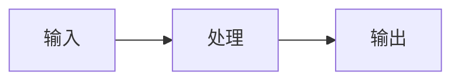

# LNN 标题

> 本页是个人学习笔记：用自己的话复述并整理，不复制课件图片。文中的 “p.N” 指课件页码。课件之外的补充会标（补充）。

## 概览

一句话总结，本讲结构（表格：板块 / 内容 / 课件页），学习目标，读完应该能回答的问题。

## 核心概念

| 概念 | 一句话解释 | 出处 / 课件页 |
| --- | --- | --- |
| | | |

## 详细笔记

按课件顺序分节，覆盖整份课件。每节标出页码范围，例如 “### 1. 某主题（p.2–16）”。

### 1. 第一节（p.N–M）

## 关键图示

以下图示是根据课件内容自行重画的 Mermaid 示意，不是课件原图。

## 重点 / 易错点

1. （待填）

## 讨论与思考题

1. （待填）

## 延伸阅读与资源

**官方指定阅读**

- （待填）

**课件中出现的论文与项目**

- （待填）

## 与项目的联系

- 对应作业：
- 对应课程项目：
- 工程检查清单：
